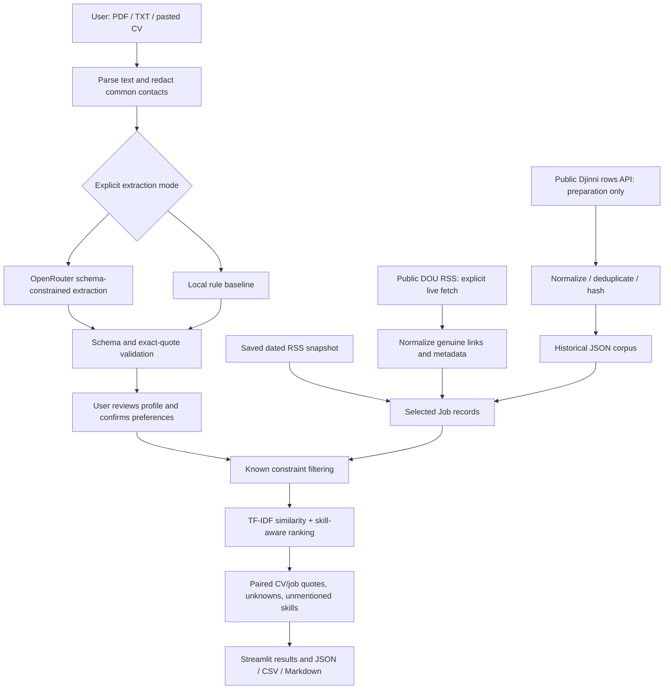

# Architecture and Walkthrough

## Data flow

## Component contracts and reasons

| Component / file | Purpose and input | Output and failure behavior | Why this choice |
| --- | --- | --- | --- |
| CV parser, `extraction.py` | <=5 MB searchable PDF or UTF-8 TXT; <=15 PDF pages and 40,000 extracted characters | Redacted text or visible input error; scans require pasted text | Small reproducible scope; pypdf runs locally |
| Rule extractor, `extraction.py` | Ukrainian/English text | `Profile`: canonical mentioned skills, explicit year count and CEFR level with exact spans | Cheap transparent baseline; clearly limited semantics |
| OpenRouter adapter, `llm.py` | Redacted text, explicit key/model; system prompt and Pydantic schema | Validated `Profile`, actual model ID; visible `ProviderError`; hash-only trace | Optional semantic extraction through one controlled model call |
| Profile validation, `extraction.py` | Profile and source CV | Reject duplicate skills, unsupported quoted facts and invalid schema | Checkable provenance independent of fluent output |
| Source adapters, `sources.py` | Public dataset rows or DOU RSS bytes | Deduplicated `Job` records; missing fields remain null; trusted DOU URL pattern | Keep source identity and unknown metadata intact |
| Preference UI / `Preferences`, `app.py` | Reviewed profile, role, city, remote preference, unknown policy | Confirmed settings required before recommendations | Avoid making up user requirements |
| Constraint filter, `search.py` | Job, candidate profile, confirmed settings | Rejection reasons and explicit unknowns | Deterministic contradictions are easier to inspect than LLM decisions |
| Search index/ranker, `search.py` | Selected jobs and CV/profile/query | Ordered recommendations and diagnostics; deterministic tie-break by ID | Compare a simple lexical model with a transparent skill-aware extension |
| Explanation builder, `search.py` | Matched known skill names and source spans | CV/job quote pairs, unmentioned job skills, unknown conditions | Traceable support without generative invention |
| Export, `export.py` | Validated recommendations, settings and diagnostics | Markdown, CSV, JSON; unconfirmed preferences or unsupported quotes fail | Useful portable result; CSV formula prefixes escaped |
| Evaluation scripts/tests | Fixed labeled cases, judged pool, source snapshots | Metrics, failures, hashes, timings and JUnit report | Measure components separately from end-to-end behavior |

`models.py` defines Pydantic contracts and rejects extra fields. `Job` retains ID/title/company/description/source/published/retrieved_at/historical/URL, derived vocabulary skills and nullable constraints. `Profile` distinguishes unknown from an asserted value. `Recommendation` contains original Job records, score, matched/unmentioned skills, unknowns and paired evidence.

## Model and external calls

- **Preparation:** ten GETs to the Hugging Face rows API on the first uncached collection; subsequent inspection reuses raw pages. The exact URLs and byte hashes are in `data/source_inspection.json`.
- **Live source:** one GET to `https://jobs.dou.ua/vacancies/feeds/` when explicitly requested. Only retrieved `https://jobs.dou.ua/companies/.../vacancies/<number>/` URLs are retained. No arbitrary browser search or private job-board API is implemented.
- **Local mode:** no inference service calls. Fixed vocabulary extraction plus a local scikit-learn TF-IDF model fitted on the selected job texts. This fitting computes vocabulary/IDF, not supervised training on relevance labels.
- **OpenRouter:** public GET `/api/v1/models`, then one POST `/api/v1/chat/completions` per CV. `response_format=json_schema`, strict Profile contract, temperature 0, maximum output 4,096 tokens, provider parameter support required. Errors are visible; no automatic retry. Actual live call quality remains unmeasured.

The CV is untrusted data in the model prompt. Schema validation and exact quotes constrain output shape and provenance, but do not establish entailment: a negated mention can still contain an exact quote. No model writes to a database or sends applications.

## Ranking and constraint details

Documents are title twice + category + description. TF-IDF uses character-within-word 3–5 grams, sublinear TF and at most 40,000 features. L2 normalization makes the dot product a cosine similarity. Lexical baseline query = CV. Skill-aware query = role repeated three times + canonical profile skills repeated twice + CV.

`score = 0.65 * lexical_similarity + 0.35 * matched_known_job_skills / known_job_skills` (coverage is zero when the job has no recognized skills). Weights are fixed design choices, not optimized benchmark parameters. Score is retrieval relevance, not a calibrated suitability probability. Job skills may describe optional tools or company context; the coverage term does not establish mandatory requirements.

Known conflicting country/experience/English/remote/city conditions reject a job. A remote job can be based in a different city. The country check excludes explicitly foreign-only records; archive/remote-only records with uncertain Ukraine eligibility are marked unknown. With unknowns excluded, archive records may all be filtered out. Historical English mapping is an approximate coarse conversion and source metadata can contradict the description. Role direction guides the query rather than imposing a category filter.

## One complete input

1. The clearly labeled synthetic `examples/data_profile.txt` supplies a 2-year Data/AI-oriented profile, Python/SQL and English B2.
2. Local extraction returns quoted fields; the user reviews them and selects Data Analytics, any city, includes visible unknown conditions, and confirms.
3. The manifest validates bytes for 1,000 historical records. Known metadata contradictions are filtered; missing country/remote data remains unknown.
4. TF-IDF and known-skill coverage rank the remaining records. `artifacts/demo/recommendations.json` records the actual result IDs, settings and diagnostics from this flow.
5. Each explanation pairs an exact CV mention with an exact job mention. Additional job vocabulary is labeled unmentioned in the CV, not a proven skills deficit.
6. The UI shows source/date/archive status and three exports. Historical records have no fabricated application link. Changing CV/source requires another search so stale recommendations are not presented as current.

All stages have evaluation evidence in `docs/evaluation_local.md`, `artifacts/evaluation_local.json` and tests; see the coverage matrix in the short report.
